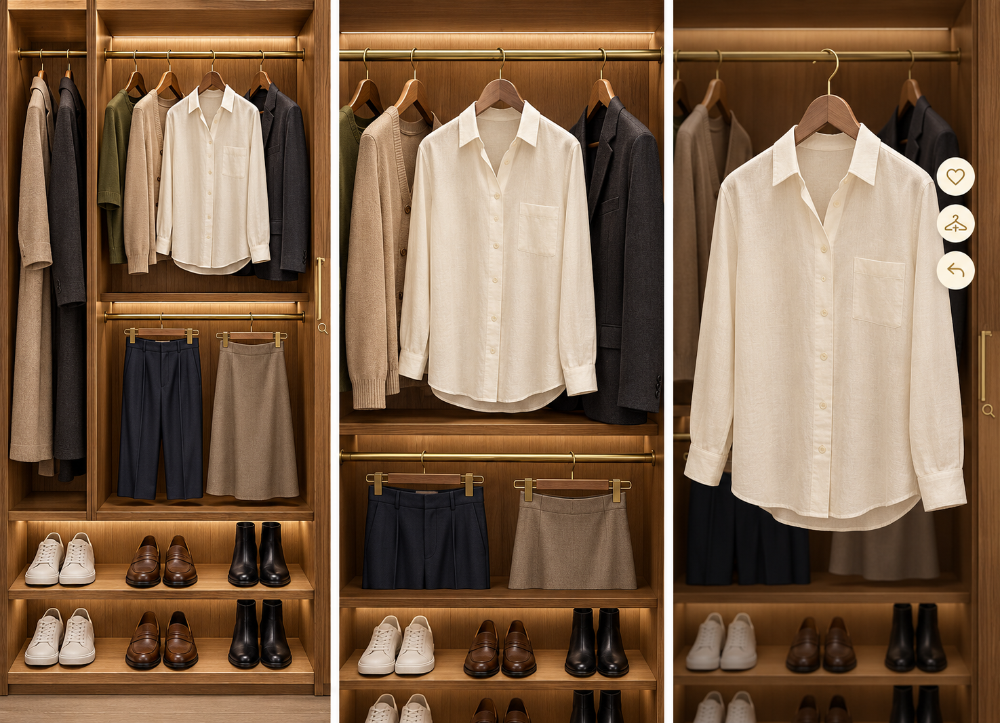
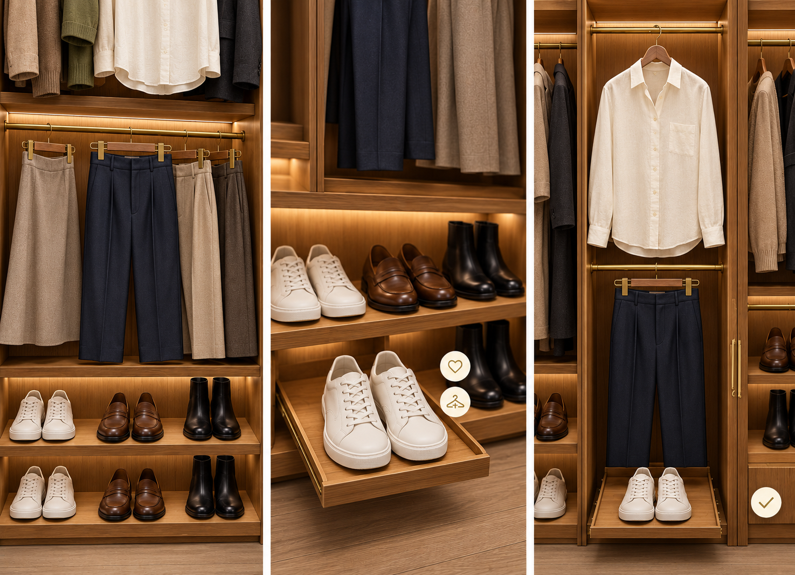

# Clozy — Immersive Closet Concept

2026-11-01。設計成果物。アプリ本体は未変更。

## 仕様

- [詳細要件定義](../../IMMERSIVE_CLOSET_UX.md)：UX・機能・視覚・動き・操作・受け入れ条件。
- [既存リポジトリへの実装設計](../../IMMERSIVE_CLOSET_IMPLEMENTATION.md)：現状との差分、コンポーネント、状態、データ、段階的実装。
- [生成プロンプトと確認記録](PROMPTS.md)：組み込みimagegenによる生成条件。

## 全景 → 横送り → 取り出し

## ボトムス → シューズ → コーデ

画像は文字なしの静止コンセプト。実装時は日付、入力、確認、エラー等に必要な日本語を表示する。
